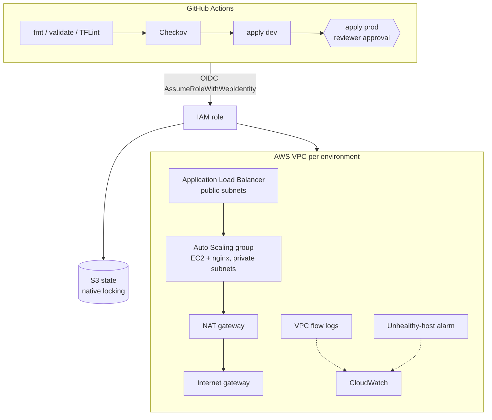

# Multi-Environment AWS Infrastructure with Terraform and GitHub Actions

Infrastructure as code for a highly available web tier on AWS, delivered by a **GitHub Actions** pipeline with linting, policy-as-code security scanning, a plan on every pull request, automatic deploys to **dev** and a manual approval gate for **prod**. The pipeline signs in to AWS with **OIDC**, so no AWS access keys are stored in GitHub.

## Architecture



## Highlights

- **Hand-written modules** (`modules/network`, `modules/web`): VPC across two AZs, public/private subnets, NAT, route tables, flow logs, ALB, launch template, Auto Scaling group with CPU target tracking and rolling instance refresh.
- **Environment promotion**: same code, `environments/dev.tfvars` and `prod.tfvars`, separate state files.
- **Keyless CI**: `bootstrap/` creates the GitHub OIDC provider and an IAM role trusted only for this repo's pull requests and its `dev` and `prod` environments.
- **Remote state**: versioned, encrypted, private S3 bucket with S3-native state locking (`use_lockfile`).
- **Quality and security gates**: `terraform fmt`, `validate`, TFLint with the AWS ruleset, and Checkov, with every skipped check documented in `.checkov.yaml`.
- **Safe applies**: the plan saved in a run is the plan that gets applied; one deploy per environment at a time; prod waits for a reviewer.
- **Hardened compute**: instances in private subnets, reachable only from the ALB security group; IMDSv2 required, encrypted EBS, SSM access instead of SSH.

## Repository layout

```
bootstrap/                  one-time: state bucket, GitHub OIDC provider, CI role
modules/network/            VPC, subnets, NAT, routes, flow logs
modules/web/                ALB, ASG, launch template, scaling policy, alarm
environments/               dev.tfvars, prod.tfvars
main.tf                     root module wiring network -> web
.github/workflows/          terraform.yml pipeline
.checkov.yaml               documented policy exceptions
.tflint.hcl                 lint rules
```

## Run it

Until step 3 is done, the pipeline runs only the checks; the AWS jobs skip themselves.

1. **Bootstrap AWS** from your laptop (an admin user in your own AWS account):
   ```bash
   cd bootstrap
   terraform init
   terraform apply
   ```
   If the account already has a GitHub OIDC provider, add `-var="create_github_oidc_provider=false"`.
2. **Create environments** in GitHub: **Settings → Environments → New environment**, named `dev` and `prod`. On `prod`, tick **Required reviewers** and add yourself.
3. **Add repository variables**: **Settings → Secrets and variables → Actions → Variables**: `AWS_ROLE_ARN` and `TF_STATE_BUCKET`, from the bootstrap outputs.
4. **Open a pull request** with any small change and read the dev plan in the run summary. Merge it: dev deploys, then the run waits for you to approve prod.
5. The URL of each environment appears in the run summary.

### Run locally instead

```bash
terraform init -backend-config="bucket=<state-bucket>" -backend-config="key=terraform-aws-multi-env/dev.tfstate" -backend-config="region=us-east-1"
terraform plan -var-file=environments/dev.tfvars
```

## Cost and cleanup

Dev (one t3.micro, ALB, NAT gateway) costs about **US$2 per day**; prod adds roughly the same again. To tear down, open **Actions → Terraform → Run workflow** and pick `dev` or `prod`. Delete the bootstrap stack last (empty the state bucket first).

## Screenshots

<!-- Add after deploying: the workflow run graph, a PR plan summary, the prod approval prompt, the page served by the ALB, the ASG instances. -->

## What I learned

<!-- 3-5 bullets in your own words. -->
